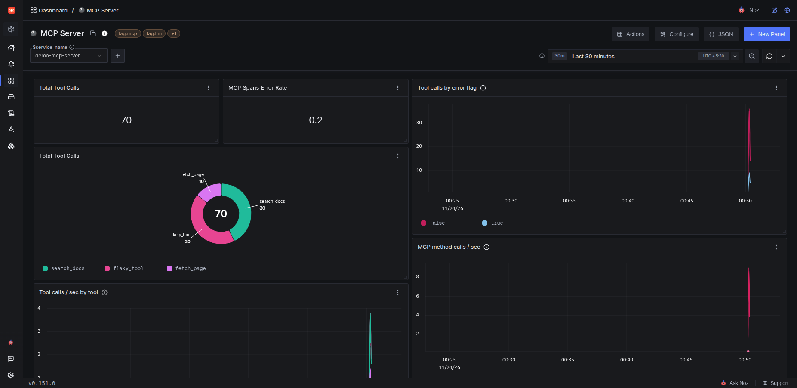
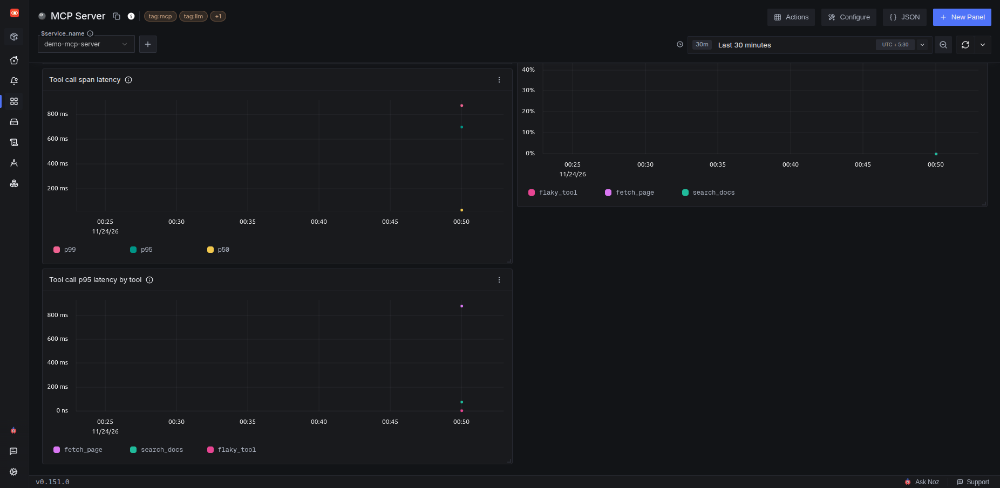

# MCP Server Dashboard - OTLP

This dashboard shows tool-call volume, latency and errors for any MCP server that sends OpenTelemetry traces. It reads only trace attributes from the MCP semantic conventions, so it does not depend on a specific server or on custom metrics. Pick the server with the `service_name` variable.

The existing [SigNoz MCP Server dashboard](../signoz-mcp/) is built for SigNoz's own MCP server: it filters on `service.name = 'signoz-mcp-server'`, the span name `execute_tool`, and the custom metrics `mcp.tool.calls`, `mcp.method.calls` and `mcp.tool.is_error`. Other MCP servers do not emit those, so this dashboard covers them.

## Sending traces

The official MCP Python SDK 2.x creates a span for every request by default (`OpenTelemetryMiddleware`). Set a tracer provider with an OTLP exporter before the server starts:

```python
from opentelemetry import trace
from opentelemetry.exporter.otlp.proto.http.trace_exporter import OTLPSpanExporter
from opentelemetry.sdk.resources import Resource
from opentelemetry.sdk.trace import TracerProvider
from opentelemetry.sdk.trace.export import BatchSpanProcessor

provider = TracerProvider(resource=Resource.create({"service.name": "my-mcp-server"}))
provider.add_span_processor(BatchSpanProcessor(OTLPSpanExporter(
    endpoint="https://ingest.<region>.signoz.cloud:443/v1/traces",
    headers={"signoz-ingestion-key": "<your-ingestion-key>"})))
trace.set_tracer_provider(provider)
```

For a self-hosted SigNoz, point the exporter at your collector (`http://<host>:4318/v1/traces`) and drop the header.

The spans this dashboard uses:

| Attribute | Example | Used for |
|---|---|---|
| `mcp.method.name` | `tools/call`, `tools/list` | method rate, error rate |
| `gen_ai.operation.name` | `execute_tool` | selecting tool calls |
| `gen_ai.tool.name` | `search_docs` | per-tool panels |
| `has_error` (span status) | `true` | error panels |

## Variables

- `{{service_name}}`: the MCP server's `service.name`

## Dashboard panels

- **Total Tool Calls**: tool calls in the selected time range.
- **MCP Spans Error Rate**: percent of MCP spans (`mcp.method.name` exists) that ended in an error.
- **Tool calls by tool**: tool calls per `gen_ai.tool.name`.
- **Tool calls / sec by tool**: per-tool call rate, stacked.
- **Tool calls by error flag**: tool calls split by `has_error`.
- **Tool call span latency**: p50 / p95 / p99 of tool-call span duration.
- **Tool call p95 latency by tool**: which tool is slow.
- **Tool call error rate % by tool**: which tool is failing.
- **MCP method calls / sec**: rate per JSON-RPC method (`tools/call`, `tools/list`, `initialize`, ...).

## Screenshots




